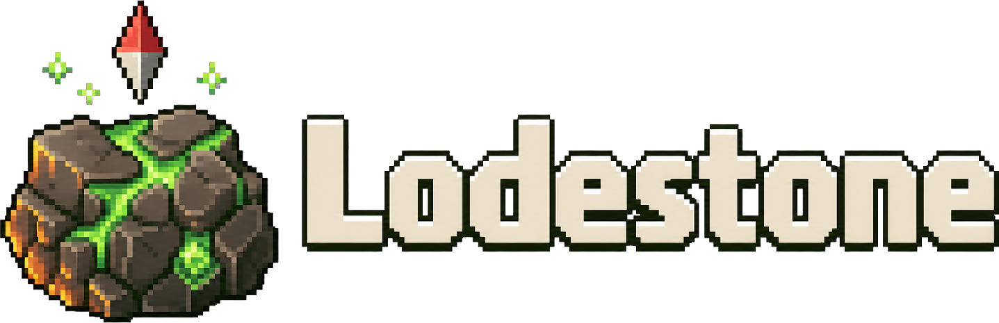
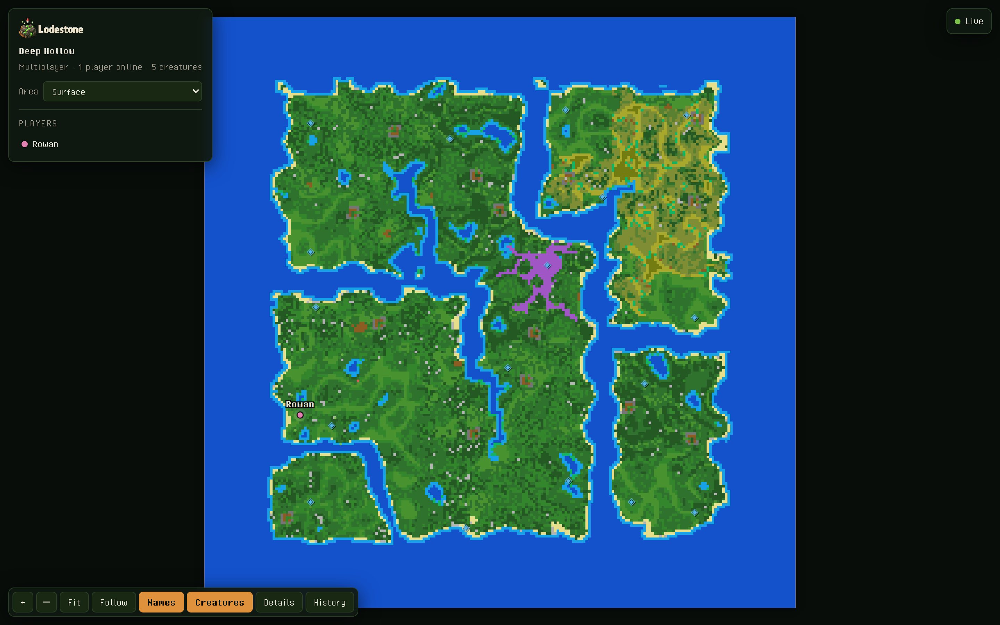

<p align="center">
  
</p>

<p align="center">
  <a href="#requirements"></a>
  <a href="https://store.steampowered.com/app/2710040/"></a>
  <a href="https://github.com/HumanGenome/Lodestone"></a>
  <a href="LICENSE"></a>
</p>

# LodestoneServer

[Delverium](https://store.steampowered.com/app/2710040/) has no dedicated server. LodestoneServer runs the game as one on a Windows machine, and players join it by IP with the [Lodestone app](https://github.com/HumanGenome/Lodestone). This repo is for hosts. Players only need the app.

## What it does

- Runs Delverium with no screen and no graphics card
- Join by IP: players connect straight to its IP and port
- Live map in a browser: the world in the game's own art, every player's position, the teleporters, and History to play back how the world changed ([docs/map.md](docs/map.md))
- Adds an in-game chat with player and admin commands, since the game has none ([docs/chat.md](docs/chat.md))
- Source RCON and a signed HTTP API for admin tools, once an admin password is set ([docs/admin-api.md](docs/admin-api.md))
- Writes a live roster file and a boot report a panel or a script can read without a login ([docs/status-and-roster.md](docs/status-and-roster.md))
- Bans and a whitelist that survive restarts
- World backups, and upload a save from a player's own game ([docs/admin-api.md](docs/admin-api.md#world-backups))
- Shows up in server lists with the real player count
- Password protection
- Up to 8 players, the game's own limit. The server doesn't use one of them.

## Known limitations

- **It isn't an anti-cheat.** Lodestone doesn't check what players do in the game.

## Requirements

| | |
|---|---|
| OS | Windows 10, Windows 11, or Windows Server |
| Game files | A Delverium installation on the host, from your own Steam copy |
| Ports | Two UDP ports, the gameplay port and the one above it for server lists. Three TCP ports above those for RCON, the admin API and the live map page, open only to the people who should reach them |
| Hardware | No GPU required. A few hundred MB of disk beyond the game. Plan for 3 GB of RAM per server: in our tests a medium world settled at about 1.2 GB, and the start that creates a world or follows a game update reached about 3 GB |

## Ports

Everything derives from one number, so you only ever choose the gameplay port.

| Port | Protocol | Used for |
|---|---|---|
| base (default `27016`) | UDP | Gameplay, the port players connect to |
| base + 1 (default `27017`) | UDP | Server query (Source A2S) |
| base + 3 (default `27019`) | TCP | Source RCON, once an admin password is set |
| base + 4 (default `27020`) | TCP | The admin API the Lodestone app's Console tab uses, once an admin password is set |
| base + 5 (default `27021`) | TCP | The live map page ([docs/map.md](docs/map.md)) |

If the RCON or admin port is already taken when the server starts, RCON moves to base + 6, then base + 8, and the admin API to base + 7, then base + 9. `/api/v1/health` lists the ports it got, and the query tags name any that moved.

The two UDP ports must be open on the host firewall and forwarded if the server sits behind NAT. Open the TCP ports only for the people who should reach them. RCON and the admin API stay off until `Password` is set under `[Admin]`; the map page is open to anyone with the address unless `AccessKey` is set under `[Map]`.

## Setup

**Before you start:** Delverium has Steam's launch check, so it closes at once when Steam didn't start it. The steps to run it on your own machine aren't written up yet.

1. Put a copy of Delverium's game files on the host from your own Steam copy: install the game through Steam on the host, or copy the game folder from a PC that has it.
2. Download `LodestoneServer-<version>.zip` from the [latest release](https://github.com/HumanGenome/LodestoneServer/releases/latest) and copy the contents of its `LodestoneServer\bepinex\` folder **over** the game folder, so `winhttp.dll`, `doorstop_config.ini`, `BepInEx\` and `dotnet\` sit next to `Delverium.exe`.
3. Put a file named `steam_appid.txt` next to `Delverium.exe` containing the single line `2710040` (`3426800` if the folder holds the free demo).
4. Start the server once from the game folder so it writes its default config files, then stop it:

   ```
   Delverium.exe -batchmode -nographics
   ```

5. Edit `BepInEx\config\com.humangenome.lodestone.host.cfg`: set the gameplay port, the server name, the world name, size and difficulty, and a join password if you want one. Set an admin password in `com.humangenome.lodestone.admin.cfg` to switch on RCON and the admin API.
6. Start the server again. The world is created on the first start. `lodestone\boot-report.txt` next to the game says `HOSTING` once players can join, or exactly what stopped it if they can't.
7. Give players the IP and port. They add it in the Lodestone app and press Connect.

Running two servers on one machine: give each its own copy of the game folder and its own gameplay port. Every other port follows from it, and each folder keeps its own saves, config and status files.

## The live map page

Open `http://<server ip>:<game port + 5>/` in a browser. The server serves the page itself, so there's nothing else to install.

<p align="center">
  
</p>

- **The map**: the world drawn from the game's own terrain art, one level at a time, redrawn as players mine, build and explore.
- **Players**: every connected player marked where they stand, refreshed every few seconds.
- **Points of interest**: the teleporters, live from the game.
- **History**: plays back how the world changed, from frames the server keeps.

The page and its JSON are open to anyone with the address. Set `AccessKey` under `[Map]` to require a key. Details and the API are in [docs/map.md](docs/map.md).

## Running it from a panel or a script

`lodestone\roster.json` is rewritten every 5 seconds with the server, world and player state. `lodestone\boot-report.txt` is the plain-text verdict of the last start. The HTTP API on port + 4 answers `/api/v1/health` without a signature, and everything that changes the server needs the admin password. Formats and the command list in [docs/status-and-roster.md](docs/status-and-roster.md) and [docs/admin-api.md](docs/admin-api.md).

## Rent a server

[SurvivalServers.com](https://www.survivalservers.com/services/game_servers/delverium/?utm_source=github&utm_medium=readme_install&utm_campaign=lodestone) runs Delverium servers with LodestoneServer installed.

## Changelog

Every server release is listed in [CHANGELOG.md](CHANGELOG.md), and its release page quotes that section word for word. The app's release notes are on the [Lodestone release pages](https://github.com/HumanGenome/Lodestone/releases).

## Contributing

See [CONTRIBUTING.md](CONTRIBUTING.md). Security issues go through [private reporting](.github/SECURITY.md), never a public issue.

Bugs: [open an issue](https://github.com/HumanGenome/LodestoneServer/issues).

## Community note

Lodestone is an independent community project. It isn't affiliated with, endorsed by, or supported by Sagestone Games.

## License

MIT, see [LICENSE](LICENSE).
